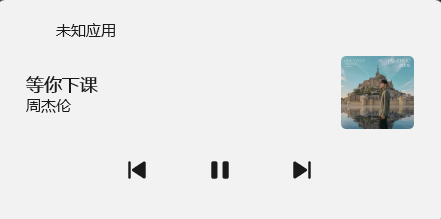

# 咪咕音乐 SMTC 修复脚本

  

：给咪咕音乐**网页版**补上「向 Windows 报歌曲信息」的能力，让**系统音量栏播放卡片**和 **Lyricify Fusion** 认出你正在听的歌。

> 咪咕网页版自己不告诉 Windows「我在放什么」，所以播放卡片是空的、歌词软件也抓不到歌。本脚本就像一个**翻译官**：把网页上的歌名、歌手、封面、播放状态抄下来，替咪咕报给 Windows。

---

## 目录

- [功能特性](#功能特性)
- [效果说明](#效果说明)
- [环境要求](#环境要求)
- [安装（推荐：链接安装，可自动更新）](#安装推荐链接安装可自动更新)
- [手动安装](#手动安装)
- [使用方法](#使用方法)
- [配置说明](#配置说明)
- [排障](#排障)
- [已知限制](#已知限制)
- [参与贡献](#参与贡献)
- [许可证与免责声明](#许可证与免责声明)

---

## 功能特性

| 功能 | 说明 |
|---|---|
| **歌曲信息上报** | 歌名、歌手、专辑、封面写入 `navigator.mediaSession` |
| **播放状态同步** | 播放 / 暂停状态实时跟随（咪咕无标准 `<audio>` 元素，靠按钮状态识别） |
| **媒体键支持** | 键盘播放/暂停、上一首、下一首直接控制咪咕播放条 |
| **秒级同步** | 网页哨兵 + 2 秒兜底巡查，切歌约 1 秒内更新 |
| **改版自救** | 咪咕页面改版后，改配置面板的「选择器」即可修复，**不用改代码** |
| **一键诊断** | 脚本猫菜单一键自检，打印「哪一步没找准」 |
| **封面内置** | 封面转为内置图片上报，减少系统偶发不刷图的情况（可见窗口下有效，见[已知限制](#已知限制)） |
| **零依赖** | 单个文件、无第三方库、无需打包编译 |
| **安静** | 日志默认关闭，需要排查时打开「调试日志」开关 |

---

## 效果说明

```text
咪咕网页 → 脚本提取 → navigator.mediaSession → 浏览器上报 → Windows SMTC
                                                    ├─ ① 系统音量栏出现播放卡片
                                                    └─ ② Lyricify Fusion 显示歌词
```

安装成功后的表现：

- 按**音量键**（或键盘播放键），播放卡片出现**歌名 + 歌手 + 封面**；
- 打开 **Lyricify Fusion**，能识别当前歌曲并显示歌词；
- 按键盘**播放/暂停/上一首/下一首**，咪咕会跟着动。

**系统音量栏播放卡片：**



**Lyricify Fusion 识别效果：**


---

## 环境要求

| 项目 | 要求 |
|---|---|
| 操作系统 | **Windows 10 / 11**（SMTC 是 Windows 独有功能，macOS / Linux 无效） |
| 浏览器 | Edge 或 Chrome（Chromium 内核） |
| 脚本管理器 | [ScriptCat 脚本猫](https://www.scriptcat.org/) 扩展 |
| 目标网站 | <https://music.migu.cn/> |

> 脚本在非 Windows 或不支持 `mediaSession` 的浏览器上会**静默退出**，不会产生任何报错。

---

## 安装（推荐：链接安装，可自动更新）

这样安装后，GitHub 上的脚本一更新，脚本猫会自动拉取新版，**不用手动复制粘贴**。

1. 安装 [ScriptCat 脚本猫](https://www.scriptcat.org/) 扩展；
2. 打开脚本猫**设置**，确认「**允许使用者脚本 / 开发者模式**」已开启（没开的话脚本完全不运行，这是最常见的「装了没反应」原因）；
3. 复制下面的地址：

   ```text
   https://raw.githubusercontent.com/bakabakbu/migu-smtc/main/migu-smtc.user.js
   ```

4. 脚本猫面板 → **新建脚本旁的下拉箭头 → 链接导入** → 粘贴地址 → 确认安装；
5. 打开或刷新咪咕音乐网页，播放一首歌，按音量键验证。

---

## 手动安装

适合临时试用或无法联网导入的情况（后续需自行更新）：

1. 打开仓库根目录的 [`migu-smtc.user.js`](./migu-smtc.user.js)，点击右上角 **Raw** 全选复制；
2. 脚本猫 → **新建脚本 → 普通脚本** → 删掉默认内容 → 粘贴 → **Ctrl + S** 保存；
3. 刷新咪咕页面即可生效。

---

## 使用方法

安装后**无需任何操作**，脚本自动运行。需要调整时再来看这里：

| 想做的事 | 怎么做 |
|---|---|
| 查看当前是否正常工作 | 脚本猫菜单 → **咪咕SMTC · 一键诊断** → F12 控制台看报告 |
| 打开排查日志 | 脚本详情 → **配置面板** → 勾选「开启调试日志」→ 保存 → 刷新页面 |
| 咪咕改版后失效了 | 配置面板里改「歌名/歌手/封面/控制按钮选择器」（见[配置说明](#配置说明)） |
| 临时停用 | 脚本猫面板里把这个脚本的开关关掉，或卸载 |

---

## 配置说明

脚本猫 → 脚本详情 → **配置面板**，共 5 项：

| 配置项 | 默认值 | 什么时候改 |
|---|---|---|
| 歌名选择器 | `.footer-player .song-name` | 卡片没有歌名时 |
| 歌手选择器 | `.footer-player .singers` | 卡片歌手为空时 |
| 封面选择器 | `.footer-player .default-cover img` | 卡片没有封面时 |
| 控制按钮选择器 | `.footer-player .custom-icon` | 媒体键失灵时 |
| 开启调试日志 | 关闭 | 排查问题时打开，**用完记得关** |

> 改完保存后**刷新咪咕页面**才生效。
> 不知道新的选择器填什么？先用「一键诊断」看哪一项显示「未命中」，或按 [排障](#排障) 步骤取新值。

---

## 排障

1. 打开配置面板勾选「**开启调试日志**」→ 保存 → 刷新页面；
2. F12 → Console；
3. 点脚本猫菜单的「**一键诊断**」，控制台会打印一份报告：

```text
===== 咪咕SMTC 诊断报告 =====
播放条：... → 命中
歌名：... → 命中，取值：xxx
歌手：... → 命中，取值：xxx
封面：... → 命中，取值：https://...
按钮：... → 命中，播放中：true
已上报给系统：xxx - xxx
当前缓存：xxx - xxx
============================
```

**怎么读**：显示「未命中」的那一项就是没找准的元素，需要更换对应选择器。

### 常见问题

| 现象 | 原因 | 处理 |
|---|---|---|
| 完全没反应，控制台无 `[咪咕SMTC]` 日志 | 脚本猫「允许使用者脚本」没开 | 打开该开关后刷新 |
| 卡片有歌名没封面 | 封面选择器失效 | 按诊断报告换封面选择器 |
| 卡片显示了**别的歌**的封面 | 咪咕换封面比歌名慢（已知现象） | 等待数秒会自动纠正；详见[已知限制](#已知限制) |
| 窗口最小化时不更新 | Windows 版 Chromium 会冻结/降速不可见窗口 | 见下节缓解办法 |

完整排障手册见 [`docs/TROUBLESHOOTING.md`](./docs/TROUBLESHOOTING.md)。

---

## 已知限制

**1. 窗口最小化时，封面可能停留在上一首**

- 原因：Windows 版 Chromium 会把最小化/被完全遮挡的窗口判定为不可见，**冻结页面渲染与定时器**。此时咪咕自己也不更新页面上的封面，脚本只能拿到旧封面；恢复窗口的瞬间会立即同步。
- 缓解办法（任选其一）：
  1. **不最小化**，改用其他窗口把它**盖住**（保持「可见」状态即可正常同步）；
  2. 给 Edge 加启动参数，禁止窗口不可见时被冻结：

     ```text
     "C:\Program Files (x86)\Microsoft\Edge\Application\msedge.exe" --disable-background-timer-throttling --disable-backgrounding-occluded-windows --disable-renderer-backgrounding --disable-features=CalculateNativeWinOcclusion
     ```

     做成桌面快捷方式后，用该快捷方式启动 Edge 生效。

**2. 咪咕改版可能导致选择器失效**

这不是 bug，改配置面板的选择器即可恢复（见[配置说明](#配置说明)）。欢迎提交 Issue 告知新选择器。

**3. 本脚本不涉及任何破解行为**

只读网页已经展示给用户的信息（歌名/歌手/封面/播放状态），**不破解付费、不下载音频、不采集或上传任何数据**。

---

## 参与贡献

欢迎提交 Issue 和 Pull Request，但请先看这两份文件：

- [`.github/CONTRIBUTING.md`](./.github/CONTRIBUTING.md)：改动流程与验收清单
- [`.github/CODE_OF_CONDUCT.md`](./.github/CODE_OF_CONDUCT.md)：行为准则

**提 Issue 前请先跑一遍「一键诊断」并把报告贴出来**——这能省下大量来回沟通。

---

## 许可证与免责声明

- 许可证：[MIT](./LICENSE)
- 本项目与咪咕音乐官方无关，纯属第三方兼容性修复；不修改、不转发任何音频内容。
- 因系统版本、浏览器策略变化导致的失效，本项目不承担责任。
